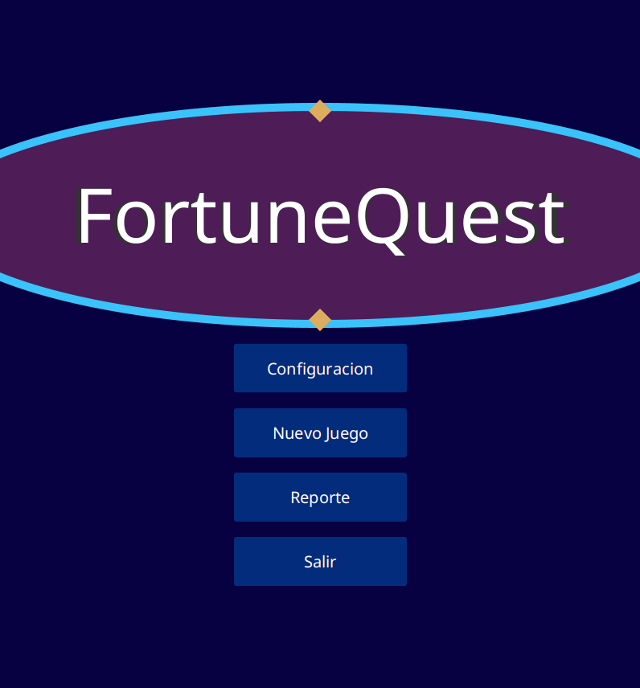
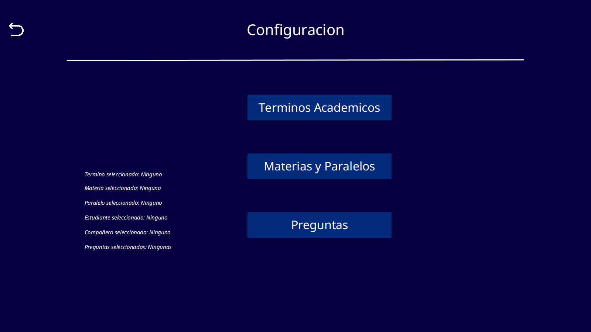
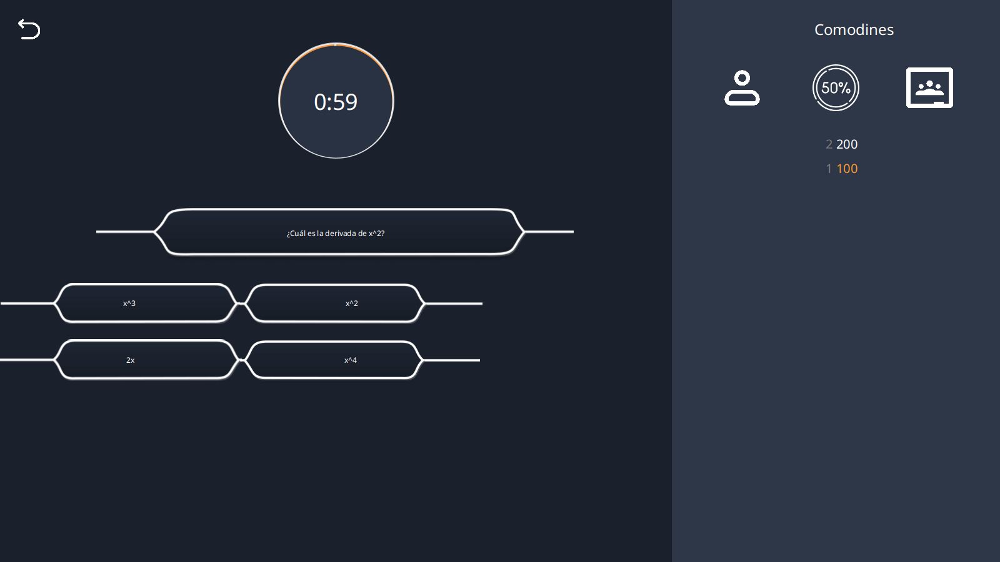

# FortuneQuest
## _Who Wants to Be a Millionaire? — Polytechnic Edition_

**FortuneQuest** is a desktop quiz game inspired by *Who Wants to Be a Millionaire?* Questions are grouped by course and difficulty level.



## Run the game

On Linux, use Java 17 or later in a graphical desktop session. Run the JAR from the project root so the game can load its sample data from `src/main/resources/org/game/files/`.

```bash
java -jar fortune_quest.jar
```

To build and run the JAR from source, use Maven from the same directory.

```bash
mvn package
java -jar target/millonario_game-1.0-SNAPSHOT-shaded.jar
```

## How to play

The game interface uses Spanish labels.

1. Open **Configuración → Términos Académicos** (Setup → Academic Terms). Select a term, click **Aceptar cambios** (Apply Changes), then use the back arrow.
2. Open **Materias y Paralelos** (Courses and Sections). Select a course and click **Aceptar cambios**. Open **Agregar paralelo** (Add Section), select an existing section, and apply the selection.
3. Under **Revisar estudiantes** (View Students), choose a student and click **Seleccionar Participante** (Select Player). Choose a different student and click **Seleccionar Compañero** (Select Teammate). Use the back arrows to return to **Configuración**.
4. Open **Preguntas** (Questions), enter the number of questions in **Preguntas por nivel** (Questions per Level), and click **Aceptar cambios**. To try the sample game, select **Cálculo de una Variable** (Single-Variable Calculus), **Paralelo 0** (Section 0), and **1** question per level.
5. Return to the main menu and click **Nuevo Juego** (New Game).



Each question has four choices and a countdown that starts at **0:59**. Click the text of an answer to select it. A correct answer advances you to the next question. A wrong answer or an expired timer ends the game.

The right panel shows your progress and three lifelines. You can ask your teammate, use **50/50** to remove two wrong answers, or ask the class. You can use one lifeline per question.



Open **Reporte** (Report) from the main menu to see past games, including the level reached, correct answers, lifelines used, and recorded prize.

## How it’s built

FortuneQuest uses **Java 17**, **JavaFX**, and **Maven**. FXML files define the screens, and JavaFX controllers connect the controls to the game logic. The data model represents academic terms, courses, sections, students, and questions. The gameplay controller updates the countdown and shuffles the answer choices. Maven packages the application and its dependencies into an executable JAR.

## License

MIT
